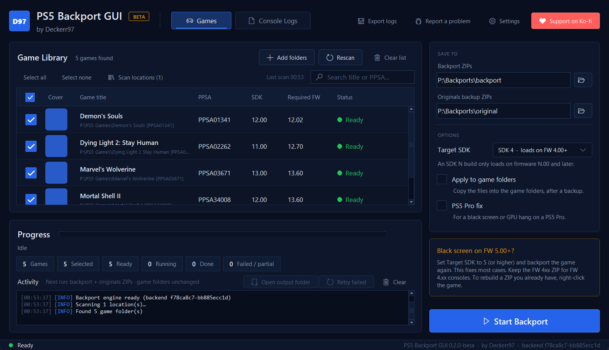

# 🎮 PS5 Backport

**Batch PS5 backporting made simpler, faster and more accessible.**

> [!WARNING]
> ## ⚠️ Important — Early Public Beta
>
> PS5 Backport is experimental software.
>
> Bugs, crashes, black screens, missing audio, save problems and firmware-specific compatibility issues may occur.
> PS5 Pro compatibility remains an active area of investigation. A game that works on one firmware or console model
> may not work on another.
>
> A completed backport does not guarantee that the game will launch or remain stable during longer gameplay.
> Always preserve your original files and keep backups. Use the tool at your own risk, and report problems with
> useful diagnostic evidence.

---

## About

After months of development, testing, debugging and improvements, I'm finally making PS5 Backport available as an
early public beta.

The goal is to make backporting easier, reduce repetitive manual work and build a reliable all-in-one solution.

We've made significant progress. In my own testing, roughly 9 out of 10 of the backports I've tried have worked on
the first attempt, but there are still issues to investigate. *This is an informal observation from internal testing,
not a measured compatibility rate, and it says nothing about any particular game, firmware or console model.*

This is not a finished release. Some games may work immediately, while others may need additional fixes or have
problems on certain firmware versions or console models. I'm releasing this beta to collect real-world testing
results, improve compatibility and keep developing the tool with the community.

---

## Closed source — early testing beta

PS5 Backport is **currently closed source**. Application source code remains private until further notice, with no promised date for a source release. This repository distributes the compiled application and public documentation for community testing.

**Windows x64 is available now. Linux and macOS are coming once I'm happy with the Windows test results. No release date is confirmed.**

## 🐛 Found a bug? Report it on GitHub

**All technical bug reports must go through [GitHub Issues](https://github.com/kerrdec97/PS5-Backport-GUI/issues).**

### [🐛 Report a Bug](https://github.com/kerrdec97/PS5-Backport-GUI/issues/new?template=bug_report.yml)

Please don't submit only “black screen”, “doesn't work”, “crashes on Pro” or “no audio”. Include the game title, PPSA ID, version, exact firmware, console model, selected options and steps to reproduce. Attach the app's **Export logs** ZIP and, for console failures, a klog, crash capture or meaningful alternative evidence. Review logs for private information before uploading. Never upload game files or proprietary binaries.

Reports missing information may be labelled `needs-information` and closed after 14 days without a response; they can be reopened when the evidence is supplied. A closed report does not mean a fix was verified. Telegram and Discord are for community discussion and announcements; GitHub Issues keeps technical reports trackable.

See [Reporting issues](docs/REPORTING_ISSUES.md).

---

## Features

Status key: **Available**: implemented; offline checks do not establish console compatibility · **Experimental**: implemented, but
little or no console testing yet · **Planned**: not in this release (see the changelog).

| Feature | Status | What it does |
|---|---|---|
| Game library | Available | Scans the folders you add (subfolders included) for extracted game folders (a folder with `eboot.bin` at its root). Reads title, PPSA ID, version, SDK and required firmware from `sce_sys/param.json`, or from the folder name when there is none. Drag and drop, search and multi-select. |
| Batch backporting | Available | Processes every selected game in turn, with per-game status, a progress bar, run statistics, *Retry failed* and cancellation. |
| Compatibility baseline | Available | Rewrites the SDK version of every title executable, fake-signs it, and adds the fakelib provider set the pipeline uses for FW 4.xx. |
| Automatic fixes | Available | Audits every executable against firmware import tables from FW 4.03 to 13.60 and applies only the fix families that have previously been confirmed working on hardware for the same problem. Anything without a confirmed fix is reported, not guessed. |
| Build verification | Available | Re-audits the finished build (including an audio check across firmware bands), verifies ZIP CRCs, signed-executable structure and the fakelib set, and refuses to output a build that fails. |
| Output | Available | Saves `FW 4xx <PPSA> <Title> (<version>) backport files.zip` to your backport folder and `<PPSA> <Title> (<version>) original files.zip` (the untouched originals of only the replaced files) to your originals folder. Nothing is overwritten; per-run manifests record SHA-256 hashes of every file. |
| Apply to game folders | Available (optional, off by default) | Copies the backport into the game folder only after the originals are backed up and verified, with a write journal, automatic rollback on failure and *Restore originals* in Settings. |
| Target SDK 5–13 | **Experimental** | Builds for a newer SDK instead of SDK 4. SDK 5 has fixed black screens and GPU hangs on newer firmware for a few titles; SDK 6–13 have not been tested on hardware. An SDK *N* build only loads on firmware *N*.00 and later. The target can't be higher than the game's own SDK. |
| Rebuild a ZIP with another SDK | **Experimental** | Right-click a game to rebuild its FW 4xx backport ZIP with the selected Target SDK. |
| PS5 Pro fix | **Experimental** | Adds the fix set confirmed on one title (Assassin's Creed Black Flag Resynced, on base and Pro consoles across several firmware versions). It has not been confirmed on any other game. |
| Console Logs tab | **Experimental** | Enter the console IP and connect: sends the bundled klog, FTP and debug payloads to your console's ELF loader, streams the live klog, automatically downloads new crash dumps into a ZIP, and takes read-only hang snapshots. Requires a jailbroken console with an ELF loader on port 9021. |
| Export logs / Report a problem | Available | Collects the app's own logs (every run's activity log, engine plan, build log and errors, no game files) into one ZIP and opens the GitHub bug form. |
| Linux and macOS builds | Planned | The first beta is Windows only. |

**Not included:** core-dump analysis, automatic hardware testing, exFAT or package inputs, and per-game fakelib
selection. These may come later; see the changelog.

---

## Download and install

**[Download the Windows beta](https://github.com/kerrdec97/PS5-Backport-GUI/releases/tag/early-testing-beta)** · [SHA-256 checksums](https://github.com/kerrdec97/PS5-Backport-GUI/releases/download/early-testing-beta/SHA256SUMS.txt)

Windows 10 or 11 (64-bit). Download `PS5BackportGUI.exe`, verify it against `SHA256SUMS.txt`, and run it. No Python or other runtime is needed. The first start unpacks the backport engine
(about 160 MB) into `%LOCALAPPDATA%\D97B`.

Full instructions: [docs/INSTALLATION.md](docs/INSTALLATION.md)

## Quick start

1. **Add folders** → choose the folder that contains your extracted games.
2. Set **Backport ZIPs** and **Originals backup ZIPs** to two separate folders.
3. Tick the games, leave **Target SDK** on SDK 4 for FW 4.xx consoles, and click **Start Backport**.
4. Copy the backport ZIP's files over the game on your console (or use *Apply to game folders* on a copy).
5. Test on the console. If something goes wrong, capture it in **Console Logs** and attach the **Export logs** ZIP to a [bug report](https://github.com/kerrdec97/PS5-Backport-GUI/issues/new?template=bug_report.yml).

---

## Documentation

- [Installation](docs/INSTALLATION.md)
- [Troubleshooting](docs/TROUBLESHOOTING.md)
- [Compatibility and test status](docs/COMPATIBILITY.md)
- [Reporting issues](docs/REPORTING_ISSUES.md)
- [Changelog](CHANGELOG.md) · [Privacy](PRIVACY.md)

---

## 💙 Credits

This project would not exist without the work and generosity of others. Mentioning them here is a thank-you, not a
claim that they endorse or maintain this project.

- **💙 [Nazky](https://github.com/Nazky)**: for the original Backport GUI
  ([Auto-Backpork](https://github.com/Nazky/Auto-Backpork)) and the foundation it provided.
- **💙 [BestPig](https://github.com/BestPig)**: for [BackPork](https://github.com/BestPig/BackPork), and for the
  continued support, guidance and help whenever it was needed. It has been genuinely appreciated.
- **💙 [drakmor](https://github.com/drakmor)**: for [Backport Helper](https://github.com/drakmor/backport-helper) and
  their contribution to the backporting community.
- **💙 Community testers**: everyone who has tested different firmware versions and PS5 Pro consoles, submitted
  useful klogs, reported and investigated crashes, tested candidate fixes and given constructive feedback.

Also thanks to [john-tornblom](https://github.com/john-tornblom) and
[ps5-payload-dev](https://github.com/ps5-payload-dev) (`make_fself`, klogsrv, ftpsrv) and
[idlesauce](https://github.com/idlesauce) (the SDK version approach). Third-party licences are listed in
[THIRD_PARTY_NOTICES.txt](THIRD_PARTY_NOTICES.txt).

**Project maintainer:** PS5 Backport by Deckerr97 · [Support on Ko-fi](https://ko-fi.com/deckerr97)

---

## Licence

PS5 Backport is proprietary software, licensed for personal, non-commercial use. The source remains private until further notice. See [LICENSE.txt](LICENSE.txt) and [THIRD_PARTY_NOTICES.txt](THIRD_PARTY_NOTICES.txt).
